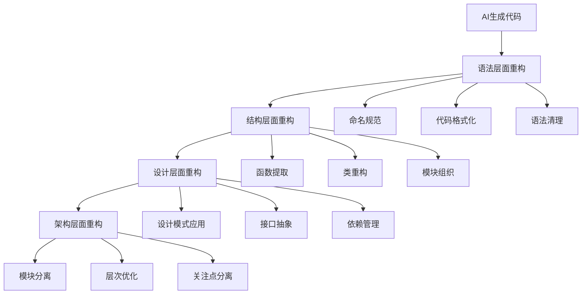

# AI时代软件重构的核心价值与方法

## 重构在AI时代的新定位

### 传统重构的回顾
重构（Refactoring）作为软件开发的核心实践，自1999年Martin Fowler《重构》一书出版以来，已经成为保证代码质量和可维护性的重要手段。重构的本质是在保持外部行为不变的前提下，通过一系列微小的语义变更来改善代码的内部结构。

### AI时代的重构挑战
随着AI工具的普及，代码生成变得前所未有地高效，这带来了新的挑战：
- **代码量激增**: AI工具能够快速生成大量代码，导致代码库规模急剧扩大
- **质量不确定**: AI生成的代码质量参差不齐，存在"能运行但设计不佳"的问题
- **技术债务积累**: 快速开发过程中容易积累技术债务
- **维护复杂性**: 大量AI生成代码的维护变得更加困难

### 重构价值的新维度
在AI时代，重构的价值不仅体现在传统意义上，更体现在：
- **质量控制**: 作为AI生成代码质量的重要保障机制
- **知识沉淀**: 通过重构将AI生成的代码转化为团队可理解和维护的知识资产
- **长期演进**: 确保代码库能够持续演进而不因AI引入的复杂性而退化

## AI生成代码的重构策略

### 1. AI代码的特性分析

#### 优势特征
- **快速原型**: 能够快速生成功能性的代码框架
- **模式识别**: 能够识别和应用常见的设计模式和实现方法
- **多样性**: 能够生成多种不同的实现方案
- **学习能力**: 能够从代码库中学习特定的编程风格和约定

#### 典型问题
- **过度复杂**: 倾向于生成比必要更复杂的代码结构
- **缺乏上下文**: 可能不理解完整的业务上下文和架构约束
- **重复性**: 可能生成重复或冗余的代码
- **非一致性**: 不同调用生成的代码风格可能不一致

### 2. 重构的优先级判断

#### 高优先级重构
- **关键路径**: 对系统性能和稳定性有重要影响的代码
- **频繁修改**: 需要频繁修改和维护的核心代码
- **团队协作**: 多人协作开发的共享代码
- **安全相关**: 涉及安全性的关键代码

#### 中优先级重构
- **工具类代码**: 内部使用的工具和辅助代码
- **实验性功能**: 新功能的实验性实现
- **一次性脚本**: 临时性的脚本和工具

#### 低优先级重构
- **原型代码**: 纯粹用于验证概念的原型代码
- **一次性工具**: 短期内使用后可能丢弃的工具
- **演示代码**: 用于演示和展示的代码

## AI时代重构的方法论

### 1. 小步快跑原则

#### 传统方法的强化
在AI时代，小步快跑的重构原则变得更加重要：
- **微步骤**: 将重构步骤分解得更小，每次只改变一个小的方面
- **频繁验证**: 每个微步骤后立即运行测试，确保行为不变
- **可回滚**: 保持每个步骤的可回滚性，降低重构风险

#### AI工具的辅助
- **智能建议**: 利用AI工具识别重构机会
- **自动化**: 使用AI工具自动化重构中的重复性工作
- **影响分析**: 让AI工具分析重构的潜在影响范围

### 2. 测试驱动重构

#### 测试先行原则
- **特征测试**: 在重构前为代码编写特征测试
- **回归测试**: 确保重构不会破坏现有功能
- **性能测试**: 验证重构对性能的影响

#### 测试生成的辅助
- **AI生成测试**: 使用AI工具生成测试用例
- **覆盖率分析**: 确保测试覆盖重构的关键路径
- **边界测试**: 重视边界情况和异常处理

### 3. 渐进式重构

#### 分层重构策略

#### 渐进式重构的实施
- **语法层**: 修复语法问题，统一命名规范，格式化代码
- **结构层**: 提取函数，重构类结构，组织模块
- **设计层**: 应用设计模式，抽象接口，管理依赖
- **架构层**: 分离模块，优化层次，分离关注点

## AI辅助重构的具体技术

### 1. 重构机会识别

#### 代码异味检测
- **长方法**: 识别过长的方法，建议提取子方法
- **大类**: 发现功能过于复杂的类，建议分解
- **重复代码**: 找出代码重复，建议提取公共逻辑
- **复杂条件**: 识别复杂的条件判断，建议简化

#### 基于AI的分析
- **语义理解**: AI分析代码的语义和意图
- **上下文感知**: 考虑代码在整个系统中的上下文
- **学习驱动**: 基于项目历史数据学习重构模式

### 2. 重构建议生成

#### 智能重构建议
- **方法提取**: 建议将代码块提取为独立方法
- **类分解**: 建议将大类分解为多个小类
- **接口抽象**: 建议提取抽象接口
- **模式应用**: 建议应用适当的设计模式

#### 重构风险评估
- **影响范围**: 分析重构可能影响的代码范围
- **风险等级**: 评估重构的风险等级
- **回滚策略**: 建议重构的回滚策略

### 3. 重构执行辅助

#### 自动化重构
- **重命名**: 智能重命名变量、方法、类
- **移动**: 移动方法到合适的类，移动类到合适的模块
- **提取**: 自动提取方法、接口、超类
- **内联**: 内联方法、变量、常量

#### 手动重构辅助
- **影响预览**: 预览重构的代码变化
- **冲突检测**: 检测重构可能引起的冲突
- **测试建议**: 建议需要更新的测试

## 重构与AI工具的协作模式

### 1. 人机协作重构

#### 协作流程
1. **AI识别**: AI工具识别重构机会
2. **人类决策**: 开发者评估重构的必要性和优先级
3. **AI建议**: AI提供具体的重构方案
4. **人类执行**: 开发者执行重构，AI提供辅助
5. **验证测试**: 运行测试验证重构结果

#### 决策原则
- **业务价值**: 优先重构对业务价值高的代码
- **维护成本**: 优先重构维护成本高的代码
- **团队能力**: 考虑团队的技术能力和熟悉程度
- **时间约束**: 在项目时间约束下合理安排重构

### 2. 重构知识库建设

#### 重构模式积累
- **成功案例**: 记录成功的重构案例
- **失败教训**: 总结重构失败的经验教训
- **最佳实践**: 建立AI时代重构的最佳实践
- **决策框架**: 制定重构决策的框架和标准

#### 知识共享机制
- **代码审查**: 通过代码审查共享重构知识
- **技术分享**: 定期进行重构技术的分享和培训
- **文档建设**: 建立重构的文档和指南
- **工具建设**: 开发重构辅助工具

## 团队层面的重构策略

### 1. 重构文化建设

#### 重构意识培养
- **价值认知**: 让团队理解重构的价值和必要性
- **技能提升**: 提升团队的重构技能和经验
- **工具使用**: 培养团队使用AI辅助重构工具的能力
- **持续改进**: 建立持续重构和改进的文化

#### 重构激励机制
- **时间分配**: 在项目计划中分配专门的重构时间
- **质量奖励**: 奖励重视代码质量的开发行为
- **技能认可**: 认可和表彰重构技能突出的团队成员
- **知识贡献**: 鼓励分享重构经验和最佳实践

### 2. 重构流程规范

#### 重构流程
- **识别阶段**: 定期识别需要重构的代码
- **计划阶段**: 制定重构计划和优先级
- **执行阶段**: 按照小步快跑原则执行重构
- **验证阶段**: 验证重构的正确性和有效性

#### 质量保证
- **代码审查**: 所有重构都需要通过代码审查
- **测试覆盖**: 确保重构代码有充分的测试覆盖
- **性能监控**: 监控重构对系统性能的影响
- **文档更新**: 及时更新相关文档

### 3. 重构工具集成

#### 工具链整合
- **IDE集成**: 将AI重构工具集成到开发环境中
- **CI/CD集成**: 在持续集成流程中加入重构检查
- **代码分析**: 集成静态代码分析工具
- **测试工具**: 集成自动测试和验证工具

#### 工具使用规范
- **标准配置**: 统一工具的配置和使用标准
- **培训支持**: 为团队提供工具使用的培训和支持
- **反馈机制**: 建立工具使用效果的反馈机制
- **持续改进**: 持续改进工具配置和使用方法

## 重构效果评估

### 1. 质量指标

#### 代码质量
- **复杂度降低**: 圈复杂度、认知复杂度的降低
- **可读性提升**: 代码可读性和可理解性的提升
- **可维护性**: 代码维护性的改善程度
- **重复度减少**: 代码重复度的降低

#### 设计质量
- **耦合度**: 模块间耦合度的降低
- **内聚性**: 模块内聚性的提升
- **抽象层次**: 代码抽象层次的合理性
- **设计模式**: 设计模式的正确应用

### 2. 生产效率指标

#### 开发效率
- **修改时间**: 代码修改时间的缩短
- **错误率**: 代码引入错误的减少
- **理解时间**: 代码理解时间的缩短
- **测试效率**: 测试编写和执行效率的提升

#### 维护效率
- **问题定位**: 问题定位时间的缩短
- **修改影响**: 修改影响范围的减少
- **回归风险**: 代码回归风险的降低
- **部署效率**: 部署效率的提升

### 3. 团队能力指标

#### 技能提升
- **重构技能**: 团队重构技能的提升
- **工具使用**: AI工具使用能力的提升
- **设计能力**: 软件设计能力的提升
- **测试能力**: 测试驱动开发能力的提升

#### 协作效果
- **知识共享**: 团队知识共享的改善
- **代码审查**: 代码审查质量的提升
- **标准化**: 开发标准化程度的提升
- **创新能力**: 创新和改进能力的提升

---

## Context
AI时代软件重构面临新的机遇和挑战，需要将传统重构智慧与AI工具能力结合，建立新的重构方法论和实践体系。

## Observations
- [insight] 重构在AI时代的价值不仅体现在代码质量上，更是将AI生成的代码转化为团队可维护知识资产的关键过程
- [method] 小步快跑、测试驱动的重构原则在AI时代变得更加重要，是处理AI生成代码不确定性的核心策略
- [design] 分层重构策略（语法→结构→设计→架构）为AI时代重构提供了系统化的实施路径
- [challenge] 在大量AI生成代码的背景下，建立重构文化、流程规范和工具集成成为团队层面的重要挑战
- [insight] 人机协作重构模式是AI时代的主要工作方式，需要重新定义开发者与AI工具的协作关系和决策机制

## Relations
- **relates_to**: [[Martin Fowler论AI时代软件开发的变革与挑战]] - Martin Fowler对AI时代重构价值的阐述
- **extends**: [[软件重构方法与实践]] - 在传统重构基础上发展AI时代的重构方法
- **implements**: [[AI辅助开发实践指南]] - 重构作为AI辅助开发的重要组成
- **requires**: [[AI时代软件测试策略]] - 重构对测试策略的新要求
- **supports**: [[代码质量管理体系]] - 重构作为代码质量管理的核心实践