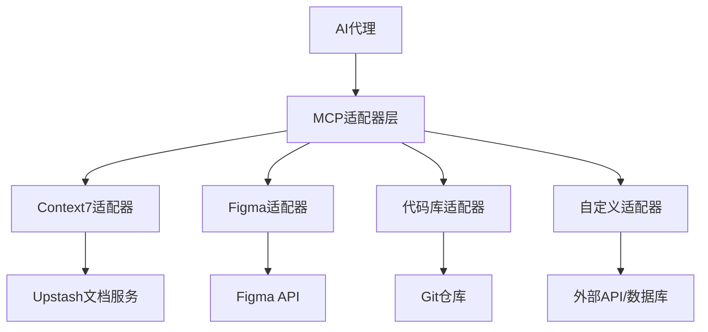

# MCP(模型上下文协议)在AI开发中的应用

## 概述

模型上下文协议(Model Context Protocols, MCPs)是专门设计用来扩展AI代理上下文的扩展，通过从外部源提供结构化数据来丰富代理的工作环境。当与规格驱动开发(SDD)结合使用时，MCPs帮助代理保持与项目目标和约束的一致性，而不是在孤立状态下工作。

## 核心价值主张

### 上下文增强
MCPs解决了AI代理的一个根本问题：缺乏实时、准确的项目上下文。传统上，AI代理依赖有限的对话历史或可能过时的信息，这导致生成的代码与实际项目状态不匹配。

### 结构化数据流
MCPs提供结构化的数据流，将外部系统的实时状态直接注入到AI代理的推理过程中。这比手动复制粘贴或依赖模糊的提示要可靠得多。

### 减少认知负荷
通过自动化上下文收集，MCPs减少了开发者为AI代理提供完整上下文的认知负荷，使他们能够专注于核心开发任务。

## 主要MCP工具和应用

### 1. Context7 by Upstash

#### 核心功能
Context7是一个专门为开发者文档优化的MCP，它为代理提供来自源头的最新、特定版本的文档和代码示例。

#### 关键特性
- **版本特定**: 提供与项目使用的确切版本匹配的文档
- **实时更新**: 直接从官方文档源获取信息，不依赖缓存或过时内容
- **精确引用**: 在提示内提供精确的文档引用，减少模糊理解
- **代码示例**: 提供与特定版本匹配的代码示例和使用模式

#### 实际价值
- **减少环境差异**: 解决"在我的机器上工作"的问题
- **版本一致性**: 确保生成的代码使用正确的API和模式
- **学习曲线平缓**: 新团队成员或AI代理可以快速了解项目的技术栈

#### 使用场景
- 当项目使用特定版本的框架或库时
- 需要确保AI生成的代码符合项目的技术标准时
- 在多个项目间切换时，需要准确的上下文切换时

### 2. Figma Context MCP

#### 核心功能
这个MCP连接器将设计工件直接带入代理的工作上下文，使AI能够理解和实现设计意图。

#### 关键特性
- **直接访问**: 直接访问Figma中的真实组件、令牌和布局
- **设计系统**: 自动获取和使用项目的完整设计系统
- **实时同步**: 与设计变更保持同步，确保实现与设计一致
- **结构化数据**: 提供结构化的设计数据，而不是截图或描述

#### 实际价值
- **设计实现一致性**: 确保代码实现与Figma设计完全一致
- **减少沟通成本**: 消除了手动传达设计意图的需要
- **自动化设计系统应用**: 自动应用正确的设计令牌和组件

#### 使用场景
- 前端开发中需要准确实现UI设计时
- 使用复杂设计系统的项目
- 需要保持多个组件间设计一致性时

## MCP与规格驱动开发的协同效应

### 互补的问题解决方式
- **规格定义应该构建什么**: SDD定义目标、需求和约束
- **MCP提供正确构建所需的实时上下文**: MCPs提供实际构建所需的精确信息

### 协作模式

#### 1. 规格作为方向
规格文档设定了项目的技术方向、架构决策和业务需求，为MCPs提供了上下文收集的目标框架。

#### 2. MCP作为事实提供者
MCPs根据规格的要求，收集相关的实时信息，如API文档、设计规范、代码库状态等。

#### 3. 持续反馈循环
规格更新触发MCP重新收集上下文，MCP发现的问题可能反过来促使规格调整。

## 实施MCP的最佳实践

### 1. 上下文来源管理
- **多样化**: 集成多个上下文源以获得全面的项目信息
- **优先级**: 确定不同上下文源的优先级和可靠性
- **更新频率**: 根据源的特性设置适当的更新频率

### 2. 上下文质量控制
- **验证机制**: 验证从MCP获取的上下文的准确性和相关性
- **冲突处理**: 处理不同MCP提供冲突信息的场景
- **版本管理**: 管理不同版本上下文的影响

### 3. 集成策略
- **渐进式采用**: 从关键的上下文源开始，逐步扩展
- **团队培训**: 确保团队理解MCP的工作原理和限制
- **监控和优化**: 监控MCP的效果，持续优化配置

## MCP的技术架构

### 1. 适配器模式
每个MCP都实现了统一的适配器接口，允许AI代理以一致的方式访问不同类型的上下文源。

### 2. 上下文缓存策略
- **短期缓存**: 缓存频繁访问的上下文以提高响应速度
- **版本感知**: 缓存时保留版本信息，确保一致性
- **失效机制**: 当源数据变化时及时更新缓存

### 3. 上下文合成
- **智能合并**: 将来自多个MCP的上下文智能合并
- **冲突解决**: 自动检测和解决上下文冲突
- **优先级处理**: 根据上下文的可靠性进行优先级排序

## MCP在不同开发阶段的应用

### 1. 需求分析阶段
- **设计系统访问**: 通过Figma MCP获取最新的设计规范
- **用户研究数据**: 集成用户研究平台的发现和洞察

### 2. 架构设计阶段
- **技术文档**: Context7提供最新的技术框架文档
- **现有代码库**: 通过代码库MCP获取现有架构信息

### 3. 开发实施阶段
- **实时设计同步**: Figma MCP确保实现与设计同步
- **API文档**: Context7提供准确的API使用方法

### 4. 测试阶段
- **测试数据**: 从测试平台获取测试用例和预期结果
- **环境配置**: 获取测试环境的配置和状态信息

## 挑战和限制

### 1. 数据一致性
- **实时性挑战**: 保持MCP数据的实时性和准确性
- **版本冲突**: 处理不同源之间的版本不一致问题

### 2. 性能影响
- **响应延迟**: 调用外部API可能增加响应时间
- **网络依赖**: 依赖外部服务的可用性和性能

### 3. 安全和隐私
- **数据访问控制**: 控制MCP对敏感数据的访问
- **审计追踪**: 记录上下文访问和使用的日志

### 4. 集成复杂性
- **配置复杂**: 多个MCP的配置和维护可能很复杂
- **错误处理**: 处理MCP服务不可用或返回错误的情况

## 未来发展趋势

### 1. 标准化
- **协议标准**: 发展通用的MCP协议标准
- **接口规范**: 统一的MCP接口规范和最佳实践

### 2. 智能化增强
- **智能筛选**: AI辅助的上下文筛选和优先级排序
- **预测性获取**: 基于上下文预测需要的信息并预获取

### 3. 生态系统扩展
- **更多MCP**: 针对不同领域和工具的专门MCP
- **社区贡献**: 开源MCP的发展和共享

### 4. 集成深化
- **IDE集成**: 与开发环境的深度集成
- **CI/CD集成**: 在持续集成流程中使用MCP

## 实施建议

### 1. 评估项目需求
- **识别关键上下文**: 确定项目最需要的上下文类型
- **评估MCP选项**: 调研可用的MCP解决方案
- **成本效益分析**: 评估实施MCP的成本和收益

### 2. 选择合适的MCP
- **功能匹配**: 选择功能与项目需求匹配的MCP
- **兼容性**: 确保MCP与现有工具链的兼容性
- **社区支持**: 考虑MCP的社区支持和活跃度

### 3. 逐步实施
- **试点项目**: 在小项目中试点MCP的使用
- **收集反馈**: 收集团队的使用反馈和改进建议
- **逐步扩展**: 基于成功经验逐步扩展到更多项目

### 4. 持续优化
- **性能监控**: 监控MCP的性能和效果
- **配置调优**: 根据使用情况调整MCP配置
- **定期评估**: 定期评估MCP的价值和ROI

---

## Context
MCP(模型上下文协议)是AI开发中的重要创新，通过提供结构化的实时上下文数据，显著改善了AI代理的代码生成质量和项目一致性。

## Observations
- [insight] MCPs解决了AI代理缺乏实时、准确项目上下文的根本问题，是连接AI能力与实际项目环境的关键桥梁
- [technique] Context7通过提供版本特定的文档和代码示例，有效解决了"在我的机器上工作"的环境差异问题
- [design] Figma Context MCP通过直接访问设计系统，实现了设计与实现的自动化一致性，大大减少了沟通成本
- [method] MCP与SDD的协同模式是：规格定义方向，MCP提供事实，这种分离关注点的设计非常有效
- [challenge] 数据一致性、性能影响、安全隐私和集成复杂性是MCP实施中的主要挑战，需要仔细考虑和规划

## Relations
- **relates_to**: [[规格驱动开发(SDD)在AI时代的实践指南]] - MCP作为SDD的重要补充
- **implements**: [[AI辅助开发技术栈优化]] - 通过丰富上下文来优化AI开发效果
- **supports**: [[设计系统自动化实施策略]] - Figma MCP为设计系统实施提供技术支持
- **enhances**: [[技术文档管理最佳实践]] - Context7为技术文档的实时应用提供新方法
- **provides**: [[实时上下文管理框架]] - 为AI开发提供系统化的上下文管理